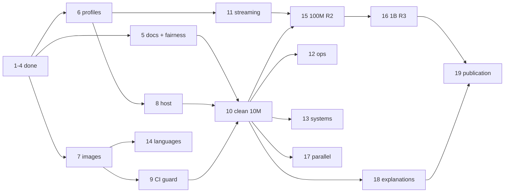

# Plan (revised after roadmap items 1-4)

Rule order is unchanged: **correctness > reproducibility > fairness > coverage.** Every item below is sized so it
ends in a merged, verified increment; later items can be dropped without invalidating earlier ones.

## 0. Goal, audience and definition of done

* **Goal:** an explainable, reproducible comparison of languages (Track L) and data systems (Track S) on the same
  operations at 10M, 100M and 1B rows, under declared and enforced CPU/memory/disk limits.
* **Audience:** data engineers choosing a language or engine; reviewers who want to rerun any number.
* **Deliverable:** `report/REPORT.md` + `report/FINDINGS.md` + per-op explanation pages, generated from one
  published campaign per scale tier, plus the exact images, profiles and commands to reproduce it.
* **Project is done when:** milestones M1-M4 (section 4) are met; every published number traces to a raw record with
  `status: ok`, a resource-profile id and a pinned toolchain; every skipped combination has a recorded reason.

## 1. Where we are

| Area | Done | Evidence |
|---|---|---|
| Data | deterministic generator, 5 tables, 1k-1B (streaming, `--sink null`), manifests, golden digests | `spec/generator.md`, `spec/golden.json`, tests |
| Oracle | 13 ops: OP01,03,04,05,06,07,08,09,10,15,19,21,22; DuckDB == pure-Python at 1k/10k/100k; OP06-09 expected-file self-checks through 100k; expected results to 10M | `runner/ops.py`, `runner/ref_ops.py`, `results/expected/` |
| Track L | python, rust, go, java, cpp, javascript, typescript (stdlib), all 13 ops; labelled `cpp-tuned` / `java-tuned` | `languages/*`; Python OP06-09 and JS/TS validated at 1k/10k/1m |
| Track S | duckdb, polars, sqlite | `systems/*` |
| Results | 804 correct timing records (1M/10M) from two campaigns; tuned variants one run only (correctness evidence) | `results/published/`, `report/REPORT.md`, `report/FINDINGS.md` |
| Resources | `taskset` pinning for single-thread runs, `ru_maxrss` peak RSS, `max_rss_gb`/timeout/disk guards, env recorded per record | `config/budget.yaml`, `runner/run.py`, `runner/sysinfo.py` |
| CI | clean-clone build of all implementations, smoke + 1k/10k correctness | `.github/workflows/` |
| Docs | data-type tables (78 `unverified` fields), conformance probes (7/13 languages run) | `docs/data-types/`, `conformance/` |

## 2. Execution resource profiles

Every timed record must name the profile it ran under. All implementations in a tier run under the **same**
profile; a run on a machine that fails the profile preflight may be used for correctness only, never published.

### 2.1 Profiles per scale tier

Disk figures use `docs/dataset-sizes.md` (estimates run 10-30% high). "Cores" means dedicated physical cores with
SMT siblings left idle; the OS and runner use cores outside the set.

| Profile | Rows | Use | Cores (pinned set) | Memory cap (cgroup) | Swap | Disk (local NVMe) | Timed runs + warm-up | Timeout / run | Modes |
|---|---|---|---|---|---|---|---|---|---|
| **R0 dev/CI** | 1k-1M | correctness only | shared runner | runner default | any | 20 GB | 1 + 0 | 600 s | both |
| **R1 10M** | 10M | first publishable tier | 4 (1 for single-thread) | 16 GB | off | 100 GB | 7 + 1 | 900 s | both; materialized if estimate x factor <= cap |
| **R2 100M** | 100M | scale tier | 8 (1 single / 4 parallel) | 32 GB | off | 500 GB (all 5 tables as Parquet + CSV ~ 245 GB est.) | 7 + 1 | 3600 s | streaming required; materialized only where it fits |
| **R3 1B** | 1B | headline tier | 16 (1 single / 4 parallel) | 64 GB | off | 2 TB (Parquet + CSV ~ 750 GB est.), or generate-on-the-fly | 3 + 1 | 4 h | streaming only |

### 2.2 Profile rules

1. **CPU:** single-thread runs pinned to one isolated core (`isolcpus`/cpuset); parallel runs pinned to a fixed set
   of 4 cores; governor `performance`, turbo either disabled or fixed and recorded; SMT siblings idle.
2. **Memory:** hard cap through cgroup v2 (`MemoryMax`, `MemorySwapMax=0`) for the whole child process tree,
   identical for every implementation; exceeding it records `status: oom` with peak RSS, never a crash of the runner.
   Engines with their own limits (DuckDB `memory_limit`, `threads`; Polars `POLARS_MAX_THREADS`; JVM `-Xmx`;
   Node `--max-old-space-size`) are set from the profile, and the values are recorded.
3. **Disk and cache:** data on local NVMe, never network storage; cache policy (`warm` after warm-up, or `cold`
   with page-cache drop) declared per campaign and recorded; free disk checked before generation.
4. **Isolation:** one benchmark process at a time; no other workload on the host; noise baseline measured before
   and after each campaign with a calibration op (target IQR/median <= 5%).
5. **Recording:** each record gets `env.profile` (id + hash of the profile file), cgroup limits read back from the
   kernel, core list, governor, kernel and image digest. The report groups and labels results by profile.
6. **Preflight:** the runner refuses a publishable campaign if cores, memory, swap, governor, disk or free space do
   not match the profile, and says which check failed.

## 3. Prioritised roadmap

Effort: S = a few hundred lines / ~1 agent task, M = 2-3 agent tasks, L = open-ended. Every item ends in a merged PR
with `docs/STATUS.md` and this plan updated. Items 1-4 keep their original numbers.

### Phase A — Trust (done)

| # | Item | Effort | Result |
|---|---|---|---|
| 1 | Trust fixes: pure-Python vs DuckDB cross-check at 100k; OP06-09 self-check through 100k; clean-clone CI; `docs/FAIRNESS_ISSUES.md` | S | **done** (#6) |
| 2 | Python OP06-09 (stdlib); Track L uniform across 13 ops | S | **done** (#7) — 75 OK at 1k/10k/1m |
| 3 | Dependency-free `cpp-tuned` (flat maps, OP04/09/10) and `java-tuned` (primitive sort, OP08), ranked separately | S | **done** (#8) — 171 OK at 1k/10k/1m |
| 4 | JavaScript and TypeScript (Node, stdlib), all 13 ops | M | **done** (#9) — 150 OK at 1k/10k/1m; 12 OK at 10m |

### Phase B — Reproducible platform (gate for any publishable number)

| # | Item | Effort | Depends on | Acceptance criteria |
|---|---|---|---|---|
| 5 | **Docs consistency + fairness review**: fix stale Python coverage in `FAIRNESS_ISSUES.md`, tuned-chart legend, STATUS phase table; per-implementation fairness checklist (build flags, collections, parsing, I/O path) reviewed by someone fluent in that language | S | — | every `impl.yaml` has a completed checklist; no doc contradicts `impl.yaml`; open disputes listed in `FAIRNESS_ISSUES.md` |
| 6 | **Resource profiles R0-R3** (section 2): `config/profiles.yaml`, runner `--profile`, cgroup v2 limits, core pinning, engine/JVM/Node limits from profile, `status: oom`, preflight, `env.profile` in records, report grouping | M | — | R0 + R1 enforced on a test host; a deliberate over-limit run records `oom`; preflight fails on a wrong core count; records carry profile id and read-back limits; tests cover each rule |
| 7 | **Pinned toolchains**: one Docker image per language/system with pinned versions and image digests; lockfiles; images used by CI and campaigns | M | — | clean rebuild yields identical toolchain versions and checksums; image digest in every record; CI runs from the images |
| 8 | **Dedicated benchmark host(s)** meeting R1/R2 (and R3 when item 15 starts): bare metal or dedicated VM, local NVMe, no noisy neighbours | S (decision) | 6 | preflight passes for R1 and R2; calibration IQR/median <= 5% over 30 runs; host spec in `docs/METHODOLOGY.md` |
| 9 | **CI and regression guard**: TypeScript type-check, chart/legend test, `make report` reproducibility check (regenerated report == committed), 1M perf smoke with a tolerance band (warn only) | S | 7 | all four checks in CI on every PR |

### Phase C — Publishable 10M baseline (M1)

| # | Item | Effort | Depends on | Acceptance criteria |
|---|---|---|---|---|
| 10 | **Single clean campaign at 10M under R1**: all implementations and variants, all 13 ops, both modes, 7 runs + warm-up, one campaign replacing the mixed 3a/3b data | M | 5-9 | <= 5% noisy cells (each noisy cell rerun once); 0 `incorrect`; report and FINDINGS regenerated from this campaign only; every FINDINGS number checked against raw data |
| 11 | **Streaming fairness**: DuckDB/Polars honour `--chunk-rows` or are reported as a separate "engine-managed streaming" mode; same chunk size across Track L | S | 6 | streaming peak RSS bounded by chunk size for all Track L; Track S streaming labelled accordingly in the report |

### Phase D — Coverage

| # | Item | Effort | Depends on | Acceptance criteria |
|---|---|---|---|---|
| 12 | **Remaining ops**: OP02 filter and OP18 date/time first, then OP20 wide scan (dataset E), OP11 window, OP12-14 (dataset D), OP16/17 I/O | M-L | 10 | per op: spec + oracle + pure-Python cross-check at 100k + expected results to 100M + >= 4 implementations OK at 1k-10M |
| 13 | **More systems**: pandas, PyArrow compute, then PostgreSQL, Spark local, ClickHouse | M-L | 6, 7 | each: pinned image, limits from profile (threads, memory), OK at 1k-10M on all supported ops, `not_run` + reason otherwise |
| 14 | **Remaining languages** (C#, Julia, Swift, Kotlin, Scala, R) via item-7 images, one at a time | L | 7 | per language: all 13 ops OK at 1k-10M under R1, README with fairness checklist |

### Phase E — Scale (M2: 100M, M3: 1B)

| # | Item | Effort | Depends on | Acceptance criteria |
|---|---|---|---|---|
| 15 | **100M under R2**: expected results to 100M (DuckDB, cross-checked on sampled chunks); every implementation that passed item 10 | L | 8, 10, 11 | each (impl, op, mode) is `ok`, `oom` or `skipped` with reason; scaling exponent 10M->100M and bytes/row in the report; campaign <= 24 h wall time |
| 16 | **1B under R3**: streaming only, 3 runs + warm-up; data on 2 TB NVMe or generated on the fly (`--sink`) with a chunked oracle; at minimum the fastest implementation per language and every Track S system | L | 15 | expected 1B checksums from two independent paths (DuckDB + chunked pure-Python digest); results labelled R3; campaign <= 72 h; documented skips |

### Phase F — Breadth and explanation (M4)

| # | Item | Effort | Depends on | Acceptance criteria |
|---|---|---|---|---|
| 17 | **Parallel variants** (fixed 4 threads on the profile's core set) for rust/go/java/cpp on OP01/03/04/10; ranked only against other `parallel` variants | M | 6, 10 | correct at 1 and 4 threads; speedup and efficiency table; Track S thread counts set to the same 4 |
| 18 | **Explanations and evidence**: `perf stat` counters and flame graphs for the top and bottom implementation per op; `report/explanations/<op>.md`; resolve the 78 `unverified` data-type fields | L | 10 | every op page cites measured evidence or marks claims "hypothesis"; `unverified` count = 0 or each remaining field justified |
| 19 | **Publication**: final report per tier (10M/100M/1B), reproduction guide (image digests, profiles, commands), changelog of methodology | M | 10, 15, 18 | an outside reader reproduces one chosen cell within the noise band using only the guide |

### Dependency order

Suggested order under a tight budget: **5 -> 6 -> 7 -> 8 -> 9 -> 10** (publishable 10M), then **11 -> 15** (100M),
then 12 (OP02/OP18), then 16 (1B). Items 13, 14 and 17 add breadth and can be dropped without affecting the headline.

## 4. Milestones

| Milestone | Contents | Exit criteria |
|---|---|---|
| **M1** Publishable 10M | items 5-11 | single R1 campaign, <= 5% noisy, report regenerated from it |
| **M2** 100M | item 15 (+ 12 for OP02/OP18) | R2 campaign, scaling table, skips explained |
| **M3** 1B | item 16 | R3 streaming campaign with dual-path oracle |
| **M4** Explained and published | items 17-19 | evidence-backed op pages, reproduction guide verified |

## 5. Known limitations and owning item

| Limitation | Owner |
|---|---|
| Report mixes two campaigns; tuned variants one run, no warm-up; 104 of 446 cells noisy | 10 |
| No enforced memory cap or dedicated cores beyond single-thread `taskset`; shared machine | 6, 8 |
| Toolchains not pinned by image digest | 7 |
| Python and SQLite validated on a subset at 10M; nothing above 10M | 10, 15 |
| DuckDB/Polars streaming ignore `--chunk-rows` | 11 |
| `compute_ms` vs `load_ms` split implementation-defined; rank by `load + compute` | 18 (document per impl) |
| `std::unordered_map` / boxed sort remain the idiomatic baselines; tuned ranked separately | by design |
| Size estimates in `docs/dataset-sizes.md` 10-30% high; 1B Parquet does not fit this container | 15, 16 |
| 78 data-type fields `unverified` (conformance output wins) | 18 |
| No TypeScript type-check or report-reproducibility check in CI | 9 |

## 6. Risks and mitigations

| Risk | Mitigation |
|---|---|
| Implementation-skill bias dominates results | item 5 checklist reviewed by language-fluent reviewers; tuned variants labelled; `FAIRNESS_ISSUES.md` |
| Oracle bug (found once: OP15 double sums) | pure-Python cross-check at 100k; dual-path oracle at 1B; exact integer sums; never hash floats |
| Noisy or mismatched hardware | profiles + preflight (item 6), dedicated host (item 8), calibration op, rerun noisy cells |
| Unequal memory/thread limits favour engines | engine/JVM/Node limits derived from the same profile and recorded |
| Hardware or disk cost for 100M/1B | generate-on-the-fly sink; drop dataset E/CSV at 1B if needed and record the skip |
| Campaign time explodes at 1B | 3 runs, streaming only, fastest-per-language subset, wall-time budgets per tier |
| Scope creep | Phase B gate before new coverage; each item ends in a merged PR; Phase D/F items droppable |
| Budget | sub-agents with tight scopes; no full campaign before its milestone gate |

## 7. How to continue (handoff)

1. Read `spec/IMPLEMENTER_GUIDE.md` (CLI/JSON contract, timing rules, Phase 3b addendum) and `docs/METHODOLOGY.md`.
2. New op: add to `runner/ops.py` (spec + oracle SQL), `runner/ref_ops.py` (pure Python), run `python -m runner specs`,
   `python -m runner.oracle --rows 1k,10k,1m,10m --op OPxx`, `pytest tests`.
3. New implementation: `languages/<lang>/` or `systems/<system>/` with `impl.yaml` (fragment auto-registered), README notes
   and the item-5 fairness checklist; validate with `python -m runner run --impl <name> --rows 1k,10k,1m --runs 1 --warmup 0 --force`.
4. Timing run (after item 6): on a host that passes the profile preflight, run the tier's profile (R1 for 10M, R2 for
   100M, R3 for 1B), copy `results/raw/*.jsonl` to `results/published/<campaign>/`, then `make report` and update
   `report/FINDINGS.md` (re-check every number against the data before merging).
5. Keep `docs/STATUS.md` and this plan current in the same PR.
